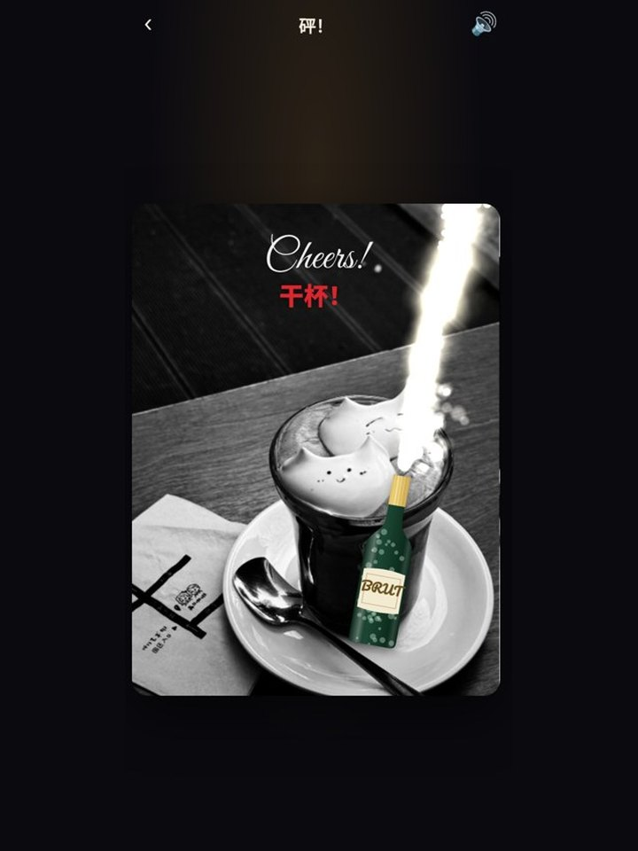
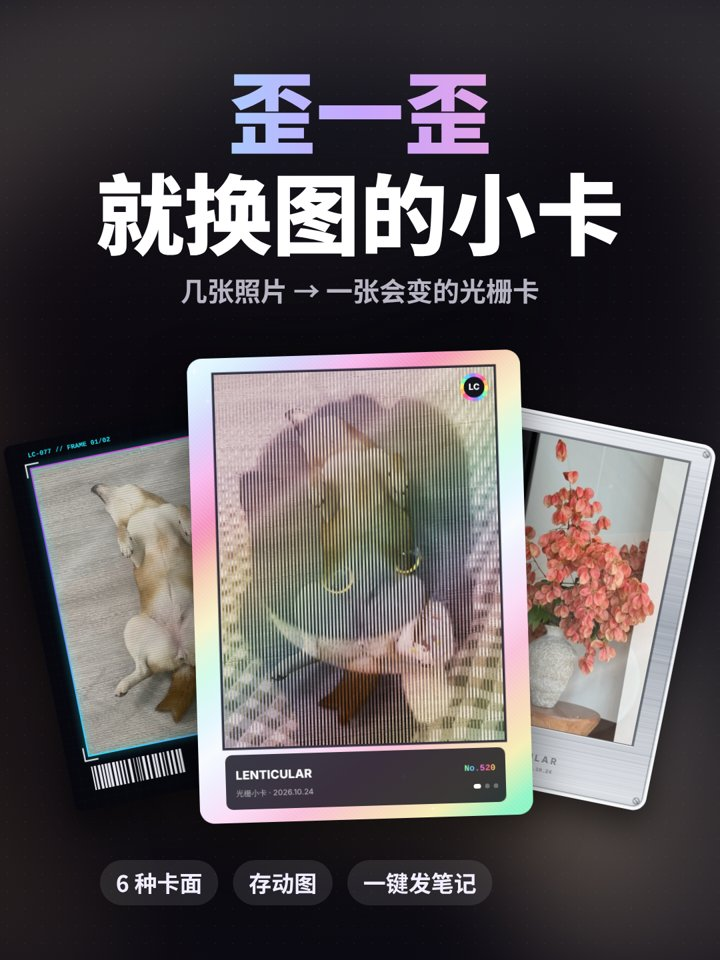
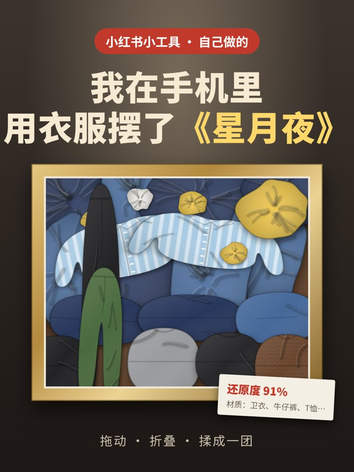

# 马良 · maliang

> 神笔马良，画什么就成什么。

**给几段视频，交回一个优美的小工具，外加一条宣传片。**

马良是一个 Agent Skill（适用于 Claude 等支持 `SKILL.md` 的智能体）。给它几段视频，带货广告、生活片段、别人家的有趣产品都可以，它会看懂视频里最让人"想要"的那一下，把它画成一个手机里就能玩的小工具。然后用这个工具的真实录屏，剪出一条 20–30 秒的竖版宣传片。

| 3D封面图 | 开香槟啦 | 光栅小卡机 |
|---|---|---|
|  |  |  |
| AI 抠出主体，冲出小红书笔记卡片 | 摇一摇手机，开瓶喷射 | 几张照片压成光栅卡：左右歪换图，上下歪虚焦 |

| 衣橱美术馆 | 邮票压花器 |
|---|---|
|  |  |
| 用虚拟衣服摆出世界名画 | 照片一按，压成一张带齿孔的邮票 |

## 产出
1. **小工具**：支持三个平台：
   - 小红书小工具：H5 离线 zip，默认平台；
   - 微信小程序；
   - Web 单页。
2. **宣传片**：1080×1920，带字幕、配乐和交互音效；有口播录音时自动对齐。
3. **图标**（1:1）、**上架封面**（3:4）和**发布文案**（3 个标题备选、正文、话题）；需要时再出笔记图。

## 流程：观 → 定 → 画 → 化 → 验 → 传
| 步骤 | 做什么 |
|---|---|
| 观 | 看懂视频：东西是什么、哪一下最爽、核心交互在现实里还是手机里 |
| 定 | 一句话说清产品，确定平台；最小功能集是"核心交互 → 产出物 → 收藏册 → 分享" |
| 画 | 六条审美原则：拟物、手感、产出是物件、沉浸、皮肤要酷、分享就绪 |
| 化 | 2D Canvas、离线运行；渲染核心与平台无关，平台差异放进适配层 |
| 验 | 用 Playwright 加平台 mock 自测、逐页截图，列出真机待验项 |
| 传 | 交付工具包，录屏并合成宣传片，附图标和文案 |

## 目录
```
SKILL.md                 主流程
references/
  aesthetics.md          审美原则
  xhs-minitool.md        小红书小工具：规则、API、版本门槛
  wechat-miniprogram.md  微信小程序
  web.md                 Web 单页
  promo.md               宣传片、图标、上架封面、发布文案
  ai-on-device.md        纯前端 AI 抠图（TF.js，不联网）
  pitfalls.md            踩过的坑
scripts/
  platform-xhs.js        小红书平台适配层（存相册、发笔记、存储、陀螺仪、振动、关注作者）
  platform-wechat.js     微信 API 的 Promise 封装
  sfx.js                 WebAudio 合成音效
  gif.js                 纯 JS GIF 编码器
  harness.js             自测截图 / CDP 高清录屏
  scenario.example.js    录屏脚本示例
  compose_promo.py       宣传片合成（字幕、配乐、音效、口播、结尾卡）
  promo.example.json     宣传片配置示例
```

## 安装
把整个 `maliang/` 文件夹放进你的智能体 skills 目录（例如 `~/.claude/skills/maliang/`），或者在支持的平台上传打包好的 skill。

**依赖**
- 自测和录屏：Node.js、Playwright（Chromium）。
- 宣传片：Python 3、numpy、Pillow、ffmpeg，以及中文字体（默认 Noto Sans CJK）。
- 做小红书小工具时，还需要官方的 `minitool-zip-builder` skill（在小红书创服平台下载）。

## 用法
直接把视频发给智能体：

> 用马良把这两段视频做成一个小红书小工具，再出一条宣传片。

不说需求也可以，马良会先说出它的猜测再开做，随时可以打断。

## 边界
- 不做硬件、后端、账号、付费。
- 不把源视频的画面、人声、商标用进产品；不克隆任何人的声音，用户本人授权的音色除外。

## 版本
见 [CHANGELOG.md](CHANGELOG.md)。

## 许可
[MIT](LICENSE)
