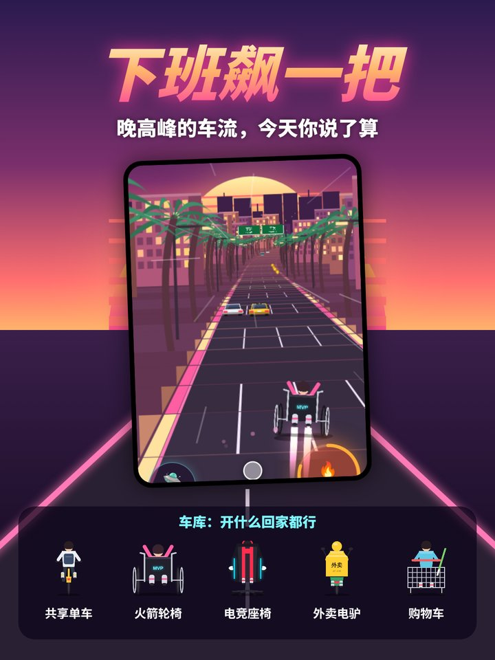
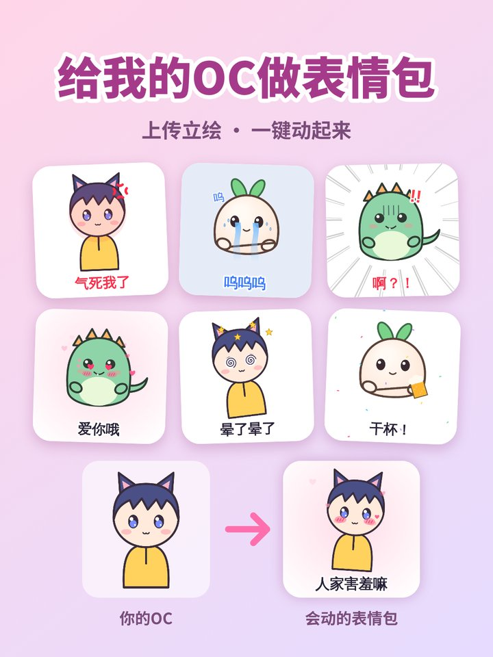

# 马良 skill

> 神笔马良，画什么就成什么。

**发一段短视频，一键生成一个能用的小程序、小工具或网站，外加一条宣传片。**

马良 skill 是一个 Agent Skill（适用于 Claude 等支持 `SKILL.md` 的智能体）。

刷到一条让人"想要"的短视频——带货广告、生活妙招、别人家的有趣产品——把它发给马良。马良会：

1. **看懂视频**：东西是什么、哪一下最爽（解压、收集、能晒）、最后的成品长什么样；
2. **画成产品**：把那个最爽的瞬间搬进手机，做成一个打开就能玩的小产品：
   - 小红书小工具（默认）：离线 H5 包，能存相册、一键发笔记、关注作者；
   - 微信小程序：完整项目目录，导入开发者工具就能跑；
   - 网站：一个单页 HTML，放到任意静态托管就能访问；
3. **自己验收**：用自动化浏览器把每一步点一遍、截图检查，再跑平台的审核脚本；
4. **剪好宣传片**：用产品的真实录屏剪出 20–30 秒的竖版视频，配字幕、配乐和交互音效，拿去就能发；
5. **备齐上架物料**：1:1 图标、3:4 上架封面、发布用的标题、正文和话题。

不需要会写代码，也不需要后端、服务器和账号体系，一切都是纯前端、离线可用。

### 适合谁
- 做"build in public"、想在小红书或 X 上持续发小作品的独立开发者；
- 想把刷到的好点子快速做成能用的小产品、先验证再说的人；
- 想给自己的账号做涨粉小工具（发笔记、关注作者都已接好）的内容创作者。

### 不适合做什么
- 需要后端、账号、支付、硬件对接的产品；
- 核心效果依赖云端大模型的产品（比如 AI 修复人脸、AI 换装）：小工具要离线运行，做不到视频里的效果，马良会先跟你说清楚。

## 作品

| 电子烟花棒 | 3D封面图 | 开香槟啦 |
|---|---|---|
|  |  |  |
| 按住点火，叫上搭子传火，解锁爱心 / 流星 / 紫电特效 | AI 抠出主体，冲出小红书笔记卡片 | 摇一摇手机，开瓶喷射 |

| 南瓜灯雕刻机 | 光栅小卡机 | 衣橱美术馆 |
|---|---|---|
|  |  |  |
| 手指刻南瓜，点上蜡烛就亮 | 几张照片压成光栅卡：左右歪换图，上下歪虚焦 | 用虚拟衣服摆出世界名画 |

| 下班飙一把 | OC表情制作器 | 邮票压花器 |
|---|---|---|
|  |  |  |
| 合成波高速公路，擦边加分、氮气起飞，开火箭轮椅飙回家 | 放一张 OC 立绘，做成会动的表情包 | 照片一按，压成带齿孔的邮票（另有微信小程序版，能「寄给朋友」） |

## 产出
1. **小工具**：支持三个平台：
   - 小红书小工具：H5 离线 zip，默认平台；
   - 微信小程序；
   - Web 单页。
2. **宣传片**：1080×1920，带字幕、配乐和交互音效；有口播时一句一个文件，画面跟着口播走，配乐自动压低，成片统一到 -16 LUFS。
3. **图标**（1:1）、**上架封面**（3:4）和**发布文案**（3 个标题备选、正文、话题）；需要时再出笔记图。

## 流程：观 → 定 → 画 → 化 → 验 → 传
| 步骤 | 做什么 |
|---|---|
| 观 | 看懂视频：东西是什么、哪一下最爽、核心交互在现实里还是手机里 |
| 定 | 一句话说清产品，确定平台；最小功能集是"核心交互 → 产出物 → 收藏册 → 分享" |
| 画 | 六条审美原则：拟物、手感、产出是物件、沉浸、皮肤要酷、分享就绪 |
| 化 | 2D Canvas、离线运行；渲染核心与平台无关，平台差异放进适配层 |
| 验 | 用 Playwright 加平台 mock 自测、逐页截图，列出真机待验项 |
| 传 | 交付工具包，录屏并合成宣传片，附图标和文案 |

## 目录
```
SKILL.md                 主流程
references/
  aesthetics.md          审美原则
  xhs-minitool.md        小红书小工具：规则、API、版本门槛
  wechat-miniprogram.md  微信小程序
  web.md                 Web 单页
  promo.md               宣传片、图标、上架封面、发布文案
  ai-on-device.md        纯前端 AI 抠图（TF.js，不联网）
  game.md                游戏类：伪 3D 赛道、爽点奖励、车库解锁、录宣传片
  pitfalls.md            踩过的坑
scripts/
  platform-xhs.js        小红书平台适配层（存相册、发笔记、存储、陀螺仪、振动、关注作者）
  platform-wechat.js     微信 API 的 Promise 封装
  sfx.js                 WebAudio 合成音效
  gif.js                 纯 JS GIF 编码器
  harness.js             自测截图 / CDP 高清录屏
  scenario.example.js    录屏脚本示例
  compose_promo.py       宣传片合成（字幕、配乐 / 外部 BGM、音效、逐段口播对齐、响度标准化、结尾卡）
  shortppt_cut.mjs       宣传片 short-ppt 版：约 3 秒一个节点重剪 + 律动 BGM，输出给 short-ppt 排版
  inline_html.py         把工具打成一个自包含 HTML，发成网页给用户手机试玩
  check_xhs_zip.py       小红书小工具 zip 自检（文件类型、大小、禁用写法、兼容性）
  immersive.css / .js    沉浸式布局组件：全屏舞台、主按钮、浮动小圆钮、底部抽屉
  promo.example.json     宣传片配置示例
  shortppt.example.json  short-ppt 版配置示例
```

## 安装
- **Claude Code**：
  ```
  git clone https://github.com/mingjuntx/maliang.git ~/.claude/skills/maliang
  ```
- **Claude 网页版 / 桌面版**：在 [Releases](https://github.com/mingjuntx/maliang/releases) 下载 zip，在设置的 Skills 里上传。
- 其他支持 `SKILL.md` 的智能体：把整个文件夹放进它的 skills 目录。

**依赖**
- 自测和录屏：Node.js、Playwright（Chromium）。
- 宣传片：Python 3、numpy、Pillow、ffmpeg，以及中文字体（默认 Noto Sans CJK）。
- 宣传片 short-ppt 版：Node.js、ffmpeg，以及 [short-ppt](https://github.com/mingjuntx/short-ppt)（Python 3.11+、Pillow、jieba、Noto Serif SC / Noto Sans SC）。
- 小红书小工具的打包自检用自带的 `scripts/check_xhs_zip.py`，不需要额外安装。上传前建议再用官方校验跑一遍：在创服平台上传页复制「第一步」的改写口令发给 AI 即可（可选）。

## 用法
直接把视频发给智能体：

> 用马良把这两段视频做成一个小红书小工具，再出一条宣传片。

> 用马良把这个视频做成一个网站。

> 用马良做一个万圣节的小工具。（没有视频也行，马良会先给几个方向）

不说需求也可以，马良会先说出它的猜测再开做，随时可以打断。

## 边界
- 不做硬件、后端、账号、付费。
- 不把源视频的画面、人声、商标用进产品；不克隆任何人的声音，用户本人授权的音色除外。
- 不把第三方图库的图打包进工具：「免费可商用」通常也禁止再分发。

## 版本
见 [CHANGELOG.md](CHANGELOG.md)。

发新版本：在 CHANGELOG.md 顶部写好 `## x.y.z（日期）` 一段，把根目录 `VERSION` 改成 `x.y.z`，推到 main。GitHub Actions 会自动打 tag、打包 zip、建 Release。

## 许可
[MIT](LICENSE) © mingjuntx
